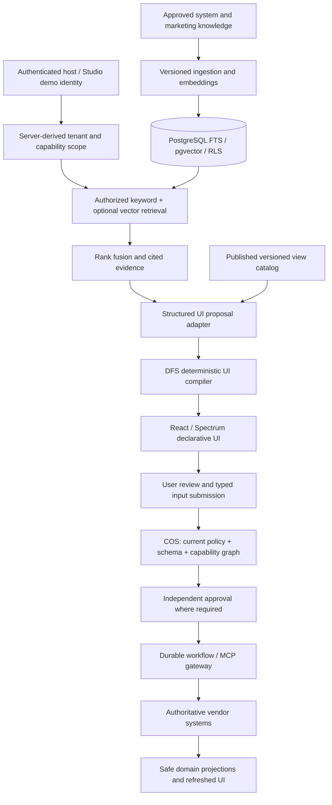

# Retrieval-grounded dynamic UI architecture

This implementation adopts the RAG/DFS/COS direction in the [uploaded v4 reference documents](../reference/v4/README.md). The documents are proposed specifications; this guide describes the executable architecture and its current limits.

## Changes from the previous design

Previously, the reference chat used a fixed campaign recipe, and dynamic forms selected a capability directly from a dropdown. The additive RAG path now retrieves authorized descriptions, approved view definitions, and approved marketing context before proposing a UI. A deterministic compiler binds the proposal to a published template and an immutable registered capability version. Studio exposes this through **RAG UI**, and campaign chat returns a retrieval-grounded preview restricted to capabilities in its validated campaign plan. The original SDK and direct schema preview remain compatible.

| Module | Responsibility |
| --- | --- |
| `@genui/retrieval-core` | Document/chunk/provenance contracts, immutable ingestion, source withdrawal, ACL/version/freshness filters, rank fusion, memory store, embedding adapters |
| `@genui/retrieval-postgres` | Persisted chunks and published views, full-text GIN index, configurable pgvector/HNSW embeddings, tenant RLS and parameterized ACL filters |
| `@genui/ui-compiler` | Published view contracts, typed model adapter, retrieved-template baseline, deterministic proposal validation, citations and schema compilation |
| Existing marketing core / workflow engine | Capability graph, policy, dependencies, approvals, execution, reconciliation and authoritative result handling |
| Studio | Trusted demo ingestion, composition/search/validation endpoints, cited UI preview, campaign chat integration |

Core remains independent of retrieval, models and PostgreSQL. Retrieval and UI compilation target Node.js; renderers consume only the existing declarative UI schema. No model-generated JSX, SQL, HTTP destinations, tools, policies or business values are accepted.

## System RAG and Marketing RAG

System knowledge includes registered capability descriptions and published UI templates. Marketing knowledge includes approved playbooks and narratives. Every source is tenant-scoped, published, versioned, ACL-filtered, and carries title, URI and update/optional expiry times. The fixture corpus has one view document per capability and one finance playbook. It deliberately contains no authoritative live metrics. Numerical analytics still come from COS/provider execution; a retrieved narrative is not a current business fact.

Publisher-controlled ingestion validates source metadata, chunks text with overlap, fingerprints the complete versioned document, and optionally embeds chunks in batches of four. Published source/view versions are immutable. Withdraw them explicitly instead of overwriting content; reingesting the old version does not undo withdrawal. There is no unauthenticated ingestion or publication endpoint. Do not ingest instructions from arbitrary uploads as trusted policy, tools, or code.

## Retrieval and generation

1. The host derives the principal, tenant, roles, and currently authorized capability versions. Studio also checks provider availability and licenses.
2. The store filters tenant, document ACL, publication state, expiry, corpus, and exact capability versions **before ranking**.
3. PostgreSQL lexical retrieval uses English full-text search and a GIN index. Optional cosine retrieval uses only compatible model IDs and dimensions. Rankings are combined using reciprocal rank fusion, with source update time breaking equal scores.
4. A provider receives allowed view candidates and explicitly untrusted evidence. A typed proposal references a template/version, capability/version, citations, optional field order and optional display title. It cannot invent actions or change validation schemas.
5. DFS rechecks source and view publication/access after the provider returns. The compiler verifies cited chunk IDs, matching view evidence, allowed field set, all required fields and exact registered schemas. Approval-bearing templates retain their published title.
6. The renderer receives an allowlisted form/table schema plus provenance. UI generation and preview validation invoke no MCP tools and perform no business mutation.
7. COS must check current capability version, authorization, schemas, dependencies, consent/eligibility and approval again before actual execution. Retrieval scores and citations are not execution permissions.

No authorized relevant published view produces a `NO_EVIDENCE` response and asks for clarification/publication. Ranking relevance is probabilistic when a semantic provider is used; deterministic validation limits what a mistaken proposal can do. It does not prove that a recommendation is the best business choice.

## Modes and model configuration

The default Studio mode is **lexical retrieval + deterministic retrieved-template selection**. This is a complete offline retrieval-grounded UI path, not an LLM demonstration.

`STUDIO_RAG_HYBRID_FIXTURE=1` enables the `fixture-token-hash-v1` embedder. These synthetic token-hash vectors test pgvector storage, compatibility and rank fusion. They do not provide semantic language understanding. The UI displays the actual retrieval method and model ID.

A production host can supply `CallbackEmbeddingProvider(modelId, dimensions, embed)` and `JSONUIProposalProvider(generate)` to `RetrievalService` / `RAGUIService`, or through the optional adapter argument to `createStudioRAG`. The model callback should put `request.instructions` in its trusted system context and serialize `request.untrustedEvidence` as data. Use model-native structured JSON output where supported. The compiler validates the result regardless of model compliance. Secrets and execution context are never passed in proposal requests.

Embedding model IDs must include the provider/model revision. Dimension is a configuration value (2..2000 for this HNSW implementation), not a hardcoded provider assumption. Re-embed and evaluate the corpus when changing a model; incompatible stored vectors are excluded and a mismatched configured query model is rejected. HNSW indexes are created for the configured model/dimension pair.

## PostgreSQL and security boundary

The adapter creates `genui_knowledge_chunks`, `genui_published_views`, and optionally `genui_knowledge_embeddings`. These new tables enable and force tenant row-level security using a transaction-local `genui.tenant_id`; missing scope sees no rows under a restricted role. ACL, freshness and capability-version filtering additionally happen in parameterized application queries. Each operation resets the tenant setting at transaction end so pooled connections cannot retain tenant context.

Use a migration/admin role to install pgvector and create tables/indexes, and a separate runtime role with required table privileges. PostgreSQL superusers bypass RLS; Studio's local development database uses a superuser, so its explicit query filters remain necessary. Tests separately verify RLS using a non-superuser role. This migration does not retroactively add RLS to existing workflow/identity tables, which retain their existing tenant-keyed application boundary.

Retrieved text and MCP descriptions are untrusted. They cannot add tool permissions or remove approval gates. Published views and connector implementations are trusted configuration. A compromised publisher or administrator requires operational containment; RAG is not a replacement for authentication, secret management, tenant enrollment or a security review.

## Current boundaries

Implemented: retrieval/ingestion contracts, memory and PostgreSQL stores, optional pgvector, RLS for new retrieval tables, published templates, provider adapters, safe composition, citations, source withdrawal rechecks, Studio integration and regression/security/browser tests.

Not implied: a configured production embedding/LLM service, free-form React generation, arbitrary generated workflows, automatic document importers for vendor knowledge, production query-quality targets, complete v4 HTTP API coverage, or production multi-user Studio authentication. Campaign chat still uses the existing validated deterministic campaign recipe for COS execution. The model adapter generates UI proposals, not an executable workflow. Live vendor behavior remains subject to the existing connector limitations.
